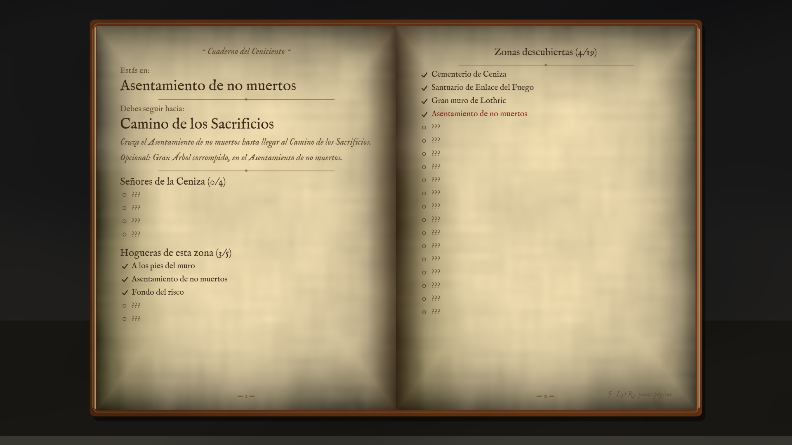
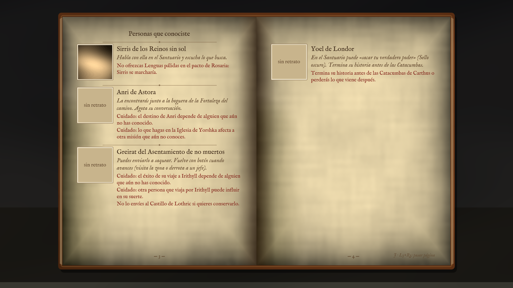

# Cuaderno del Ceniciento

Mod para **DARK SOULS III** (versión 1.15.2): un cuaderno de viaje de papel antiguo que te orienta sin quitarte la exploración. Pulsa una tecla y se abre un libro con animación de tapa y de páginas, a pantalla completa, con todo lo que has descubierto en tu partida.



## Qué contiene el cuaderno

| Apartado | Qué muestra |
|---|---|
| **Zonas** | Dónde estás, hacia dónde seguir en la historia, Señores de la Ceniza, hogueras de la zona y zonas descubiertas (las que no conoces salen como «???»). |
| **Misiones** | Principales (se tachan al cumplirlas, la actual en rojo, las futuras ocultas) y secundarias de cada persona que conoces. |
| **Objetos clave** | Llaves, tomos, cenizas de Señor… con para qué sirven y a qué misión o NPC están ligados. |
| **Coleccionables** | Cenizas para la Sirvienta, carbones para Andre, tomos y pergaminos: lo que llevas sin entregar y lo ya entregado. |
| **Jefes** | Los 25 jefes (base + DLC), derrotados o pendientes, sin revelar los que no has visto. |
| **Personas** | Cada NPC aparece al hablarle por primera vez, con **un retrato en sepia que el mod toma solo**, dónde está ahora, qué hace falta para que su historia avance y avisos sobre misiones ligadas (sin destripar finales). |



Las misiones de los NPCs no están escritas de memoria: el mod usa las **máquinas de estado de los scripts de eventos del juego** (qué fase activa a cada NPC en cada mapa y qué condición lo hace avanzar), extraídas con las herramientas de este repositorio.

## Importante: juega sin conexión

El mod se carga como un DLL. **Usarlo en línea puede provocar un baneo.**
Pon el juego en *Opciones del sistema > Red > Iniciar en modo sin conexión*. Si el juego está en línea, el cuaderno no hace nada salvo mostrar un aviso. Para jugar en línea, quita el mod (o la opción de lanzamiento en Linux).

## Instalación

1. Descarga el zip del último [release](../../releases).
2. Copia `dinput8.dll` en `...\DARK SOULS III\Game\`.
3. **Linux / Steam Deck (Proton):** en Steam > Propiedades > Opciones de lanzamiento:
   ```
   WINEDLLOVERRIDES="dinput8=n,b" %command%
   ```
4. Abre el juego sin conexión y carga tu partida.

Desinstalar: borra `dinput8.dll` (y si quieres la carpeta `CuadernoDS3`) de la carpeta `Game`.

## Controles

| | Abrir / cerrar | Página siguiente | Página anterior | Repetir retrato (en una conversación) |
|---|---|---|---|---|
| Teclado | K | L | J | P |
| Mando | L3 + R3 | R3 | L3 | — |

Con el cuaderno abierto, el juego no recibe L3 ni R3. **El juego no se pausa**: ábrelo en zonas seguras. Todo se cambia en `Game\CuadernoDS3\config.ini` (teclas, botones, `escala`, `volumen`).

## Archivos que crea

- `Game\CuadernoDS3\config.ini` — configuración.
- `Game\CuadernoDS3\partidas\<personaje> - ranura N\` — personas conocidas, zonas, objetos vistos y retratos de cada partida.
- `Game\CuadernoDS3.log` — registro (útil para informar fallos).

## Compilar (Linux)

Necesitas MinGW-w64 (`mingw64-gcc-c++`) y `xxd`. Dear ImGui y MinHook van en `terceros/`.

```sh
./compilar.sh          # genera build/dinput8.dll
```

Herramientas (`herramientas/`, Python): extraer textos y scripts de eventos de tu copia del juego, generar la tabla de misiones (`misiones.py` + `generar_misiones.py` → `src/misiones_gen.h`), probar el cuaderno con Proton en modo demostración (`probar_demo.sh`). Para extraer archivos necesitas las claves públicas de los `.bhd` (las publica [BinderTool](https://github.com/Atvaark/BinderTool)) y el `ds3-common.emedf.json` de [SoulsRandomizers](https://github.com/thefifthmatt/SoulsRandomizers); no se incluyen aquí. **Este repositorio no contiene archivos del juego.**

## Créditos

- Direcciones de memoria y flags investigados con ayuda de [SoulSplitter](https://github.com/FrankvdStam/SoulSplitter), la tabla [The Grand Archives](https://github.com/The-Grand-Archives/Dark-Souls-III-CT-TGA), el [randomizer de thefifthmatt](https://github.com/thefifthmatt/SoulsRandomizers), [BinderTool](https://github.com/Atvaark/BinderTool) y [SoulsFormats](https://github.com/soulsmods/SoulsFormatsNEXT). No se ha copiado código de esos proyectos.
- [Dear ImGui](https://github.com/ocornut/imgui) (MIT) y [MinHook](https://github.com/TsudaKageyu/minhook) (BSD-2-Clause).
- Fuente IM FELL English de Igino Marini (SIL Open Font License 1.1).
- Nombres de lugares, NPCs y objetos: textos oficiales en español del juego. DARK SOULS es una marca de FromSoftware / Bandai Namco; este es un mod de fans sin relación con ellas.

## Licencia

[MIT](LICENSE) © 2026 Angel
